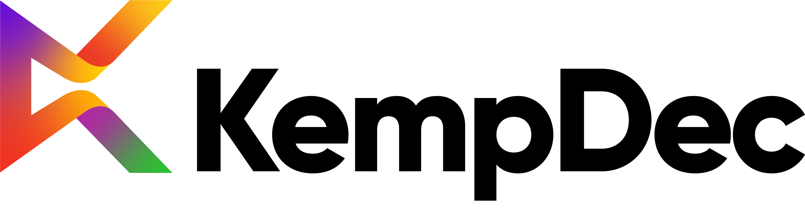

  <a href="https://kempdec.com">
    <picture>
      <source media="(prefers-color-scheme: dark)" srcset="img/logo-kempdec-branco.png">
      
    </picture>
  </a>

  
<strong>Software próprio, por assinatura, feito com o cuidado de produto premium.</strong>

## Produtos

- **[Fynance](https://fynanceapp.com)**: controle financeiro pessoal e empresarial.
- **[KempDec Markdown](https://markdown.kempdec.com)**: editor de Markdown no navegador e no Windows.

## Código aberto

- **[AutoRelease](https://github.com/kempdec/AutoRelease)**: a versão e as notas de versão a partir das mensagens de commit.
- **[autorelease-action](https://github.com/kempdec/autorelease-action)**: o AutoRelease no GitHub Actions.
- **[NetWindowsFirewall](https://github.com/kempdec/NetWindowsFirewall)**: as regras do Firewall do Windows a partir do seu programa .NET.

## Contato

[kempdec.com](https://kempdec.com) · [contato@kempdec.com](mailto:contato@kempdec.com)
